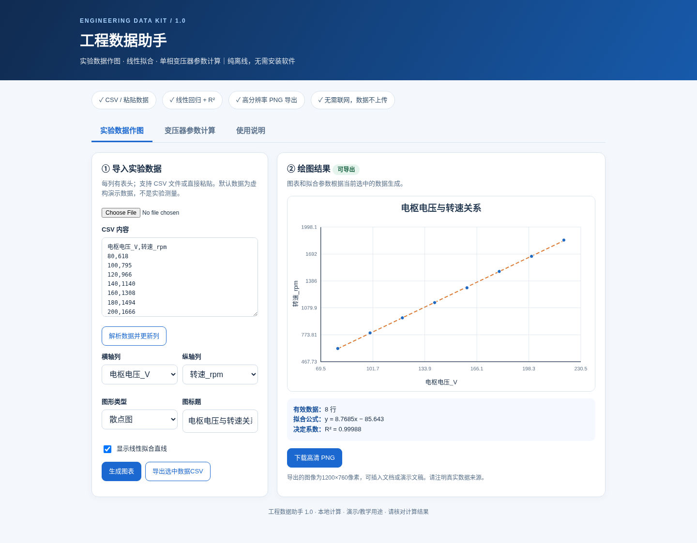

# 工程数据助手（Engineering Data Assistant）

轻量级、无需服务器的工程实验数据分析工具。这里提供可以运行的免费基础版，**不包含计划单独销售的专业增强版**。

## 功能

- 输入或本地导入两列简单 CSV 数据（首行表头，至少两组数据，最多 5000 组）。
- 绘制散点图与普通最小二乘线性拟合直线。
- 计算拟合方程和决定系数 R²。
- 本地离线运行，不向服务器发送数据。

限制：仅支持简单英文逗号分隔，暂不处理带引号和嵌入逗号的复杂 CSV 字段；此版本不提供 PNG 导出、变压器参数计算等增强功能。重要工程结果请自行复核。

## 使用

1. 下载 `index.html` 与 `core.js`，保存到同一个文件夹。
2. 用 Edge、Chrome 等现代桌面浏览器打开 `index.html`。
3. 粘贴两列 CSV 数据或选择本地 CSV 文件，点击「重新计算」。

`demo.csv` 是用于演示的**虚构测试数据**，不是实测结果。直接使用网页不需要安装 Node.js。

## 测试

开发者安装 Node.js 后运行：

```bash
node --test tests/core.test.cjs
```

包含 CSV 解析、线性拟合、异常数据和边界输入的五项回归测试。

## 界面



## 开发与反馈

- 欢迎在 Issues 中报告可复现的问题，详见 [CONTRIBUTING.md](CONTRIBUTING.md)。
- 项目处于早期测试阶段，无法宣称已有大规模用户或成熟的商业交付。
- 计划改进 CSV 兼容性、数学测试和工程实验示例。

## 许可和商业版

**本仓库的免费基础版源码及文档采用 [MIT License](LICENSE) 发布。** 你可以在保留许可及版权声明的前提下使用、修改、分发和商业使用此免费版本。`screenshot.png`、`demo_preview.png` 等品牌/界面展示图片不属于此源码授权范围，除非得到单独许可；商品名称、Logo 和商标亦不被授予使用权。商业增强版的代码及安装包从未包含在本仓库，不受本仓库 MIT 许可约束。

> 注意：此 MIT 许可证已加入拟议的 PR 分支。合并前默认分支仍为原有状态。

维护者：工程工具实验室。爱发电主页：https://afdian.com/a/engineeringtools
